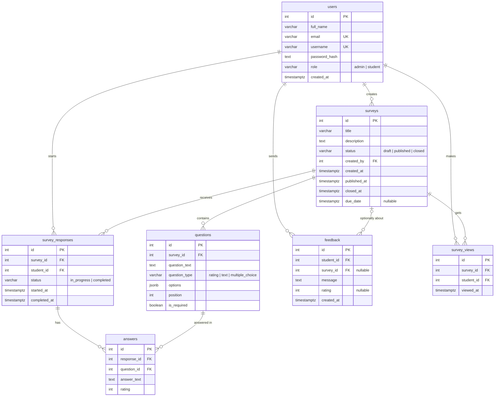

# Database – Campus Feedback

PostgreSQL database for **Campus Feedback**. Schema initialization lives in `init.sql`, which executes automatically the first time the database container starts with an empty named volume. Shared, portable seed datasets live under `database/seeds/dev_seed.json`.

---

## 1. Entity Relationship Diagram (ERD)



---

## 2. Table Specifications

| Table | Purpose | Primary Constraints |
| :--- | :--- | :--- |
| `users` | User credentials, profiles, and roles | `PK (id)`, `UNIQUE (email)`, `UNIQUE (username)`, `CHECK (role IN ('admin', 'student'))` |
| `surveys` | Survey definitions, deadlines, and lifecycle state | `PK (id)`, `FK (created_by)`, `CHECK (status IN ('draft', 'published', 'closed'))` |
| `questions` | Survey question items and configurations | `PK (id)`, `FK (survey_id ON DELETE CASCADE)`, `CHECK (question_type IN ('rating', 'text', 'multiple_choice'))` |
| `survey_responses` | Student survey submission attempts | `PK (id)`, `FK (survey_id)`, `FK (student_id)`, `UNIQUE (survey_id, student_id)` |
| `answers` | Student response to an individual question | `PK (id)`, `FK (response_id ON DELETE CASCADE)`, `FK (question_id ON DELETE CASCADE)`, `UNIQUE (response_id, question_id)` |
| `feedback` | Direct feedback sent by students | `PK (id)`, `FK (student_id ON DELETE CASCADE)`, `FK (survey_id ON DELETE SET NULL)` |
| `survey_views` | Audit logs of survey views for conversion analysis | `PK (id)`, `FK (survey_id ON DELETE CASCADE)`, `FK (student_id ON DELETE CASCADE)` |

---

## 3. Business Logic & Query Patterns

### 3.1. Survey Expiration & Lifecycle State
- The `surveys.status` check constraint restricts status to `draft`, `published`, and `closed`.
- **Manually Closed Surveys:** Have `status = 'closed'` and `closed_at` set.
- **Expired Surveys:** Have `status = 'published'` and `due_date < NOW()`. The database preserves `'published'` to respect schema constraints, while the application computes `is_expired: true` and `effective_status: 'expired'`.
- All response and answer records for expired surveys remain intact for historical metrics.

### 3.2. 7-Day Dynamic Activity Aggregation
Activity metrics are computed dynamically over the last 7 calendar days without mock data:

```sql
WITH days AS (
  SELECT (CURRENT_DATE - (i || ' day')::interval)::date AS day_date
  FROM generate_series(6, 0, -1) AS i
),
views_agg AS (
  SELECT viewed_at::date AS day_date, COUNT(*)::int AS count
  FROM survey_views
  WHERE viewed_at >= CURRENT_DATE - INTERVAL '6 days'
  GROUP BY viewed_at::date
),
responses_agg AS (
  SELECT completed_at::date AS day_date, COUNT(*)::int AS count
  FROM survey_responses
  WHERE completed_at >= CURRENT_DATE - INTERVAL '6 days' AND status = 'completed'
  GROUP BY completed_at::date
)
SELECT 
  d.day_date,
  TO_CHAR(d.day_date, 'Dy') AS weekday_label,
  TO_CHAR(d.day_date, 'YYYY-MM-DD') AS date_str,
  COALESCE(v.count, 0) AS views_count,
  COALESCE(r.count, 0) AS responses_count
FROM days d
LEFT JOIN views_agg v ON d.day_date = v.day_date
LEFT JOIN responses_agg r ON d.day_date = r.day_date
ORDER BY d.day_date ASC;
```

---

## 4. Multi-Developer Database Seed Merging

Portable development seeds are maintained in `database/seeds/dev_seed.json`.

- **Exporting Data:** Run `npm --prefix backend run seed:export` to dump local surveys, questions, responses, answers, feedback, views, and users.
- **Importing & Merging Data:** Run `npm --prefix backend run seed:import` to safely merge records from another developer's seed file. Numeric IDs are remapped into local sequences, foreign keys are preserved, and existing local records are protected from overwrite.
