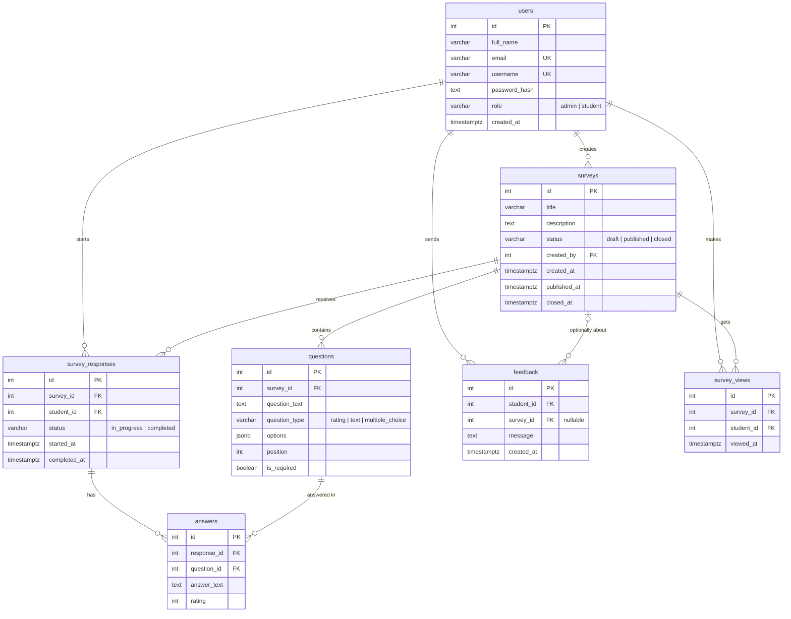

# Database – Student Feedback System

PostgreSQL database for the Student Feedback System. The schema and seed data live in `init.sql`, which runs automatically the first time the database container starts with an empty volume.

## ERD

## Tables

| Table | Purpose |
|---|---|
| `users` | Accounts and roles (admin / student) |
| `surveys` | Survey title, description, status and publish/close dates |
| `questions` | Questions, their types and order |
| `survey_responses` | A student's attempt and its completion status |
| `answers` | Answers to each question |
| `feedback` | General comments sent by students |
| `survey_views` | Survey views, used to calculate statistics |

## Notes

- `init.sql` runs only when the volume is empty. After editing it, recreate the volume: `docker compose down -v`.
- Statistics (views, attempts, completion rate) are computed from stored data with queries, not stored.
- Seed accounts are for development only; change their passwords before real use.
