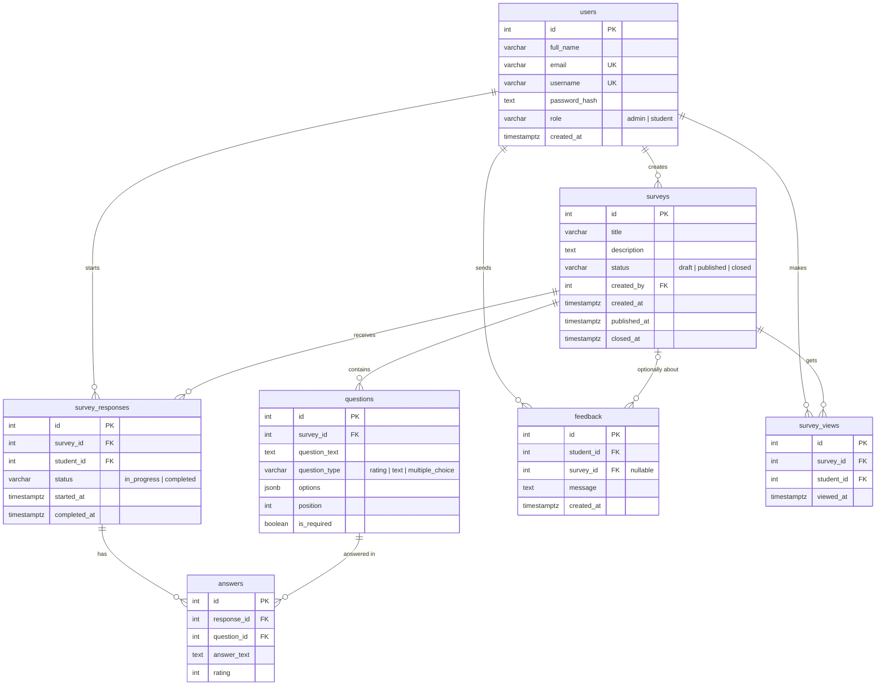

# Database – Student Feedback System

PostgreSQL database for the Student Feedback System. The schema and seed data live in `init.sql`, which runs automatically the first time the database container starts with an empty volume.

## ERD

## Tables

| Table | Purpose |
|---|---|
| `users` | Accounts and roles (admin / student) |
| `surveys` | Survey title, description, status and publish/close dates |
| `questions` | Questions, their types and order |
| `survey_responses` | A student's attempt and its completion status |
| `answers` | Answers to each question |
| `feedback` | General comments sent by students |
| `survey_views` | Survey views, used to calculate statistics |

## Normalization

The schema is designed to satisfy Third Normal Form (3NF), with one deliberate simplification noted below.

**First Normal Form (1NF).** Every column holds a single atomic value and there are no repeating column groups. For example, a student's answers are stored as separate rows in `answers` (one row per question), not as columns like `answer1`, `answer2`, `answer3`.

**Second Normal Form (2NF).** Every table uses a single-column primary key (`id`), so no non-key column can depend on only part of a key. Business rules that involve two columns, such as one attempt per student per survey, are enforced with `UNIQUE (survey_id, student_id)` on `survey_responses` and `UNIQUE (response_id, question_id)` on `answers`.

**Third Normal Form (3NF).** No non-key column depends on another non-key column. Each fact is stored once and referenced by foreign key: a student's name lives only in `users`, a survey's title only in `surveys`, and a question's text only in `questions`. Derived values such as views, completion rate and response counts are not stored; they are calculated from the recorded data by queries.

**Deliberate simplification.** The `options` column in `questions` stores the choices of a multiple-choice question as a JSONB array. Strictly, this is a list inside one column. We kept it because the options are only displayed together with their question and are never queried or updated individually, and a separate `question_options` table would add joins without benefit at this project's scale. If full normalization were required, it would be replaced by a `question_options (id, question_id, option_text, position)` table.

## Notes

- `init.sql` runs only when the volume is empty. After editing it, recreate the volume: `docker compose down -v`.
- Statistics (views, attempts, completion rate) are computed from stored data with queries, not stored.
- Seed accounts are for development only; change their passwords before real use.